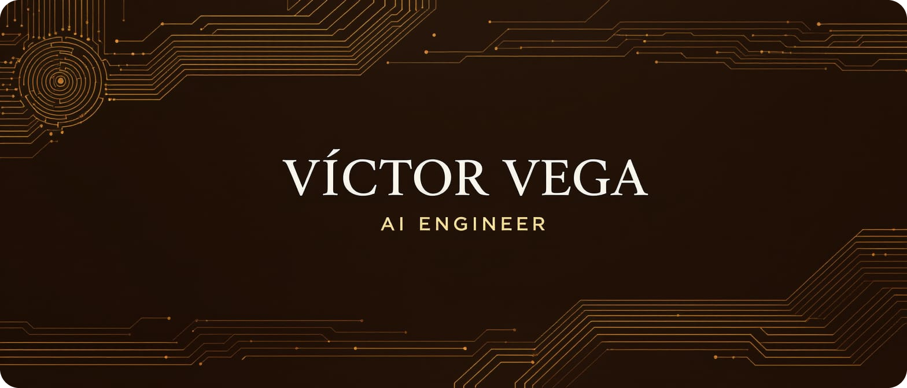
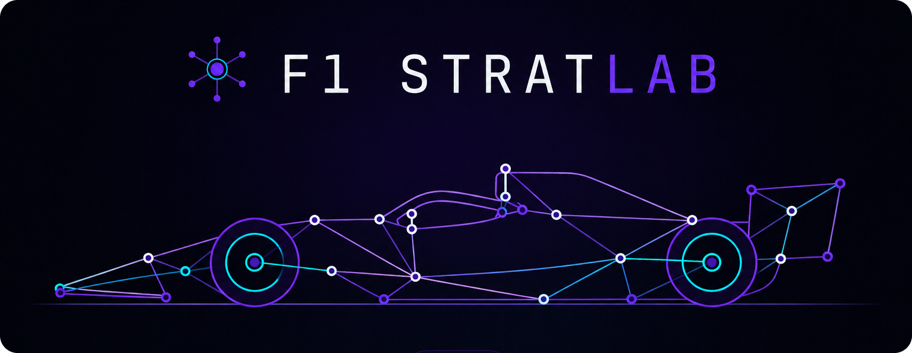
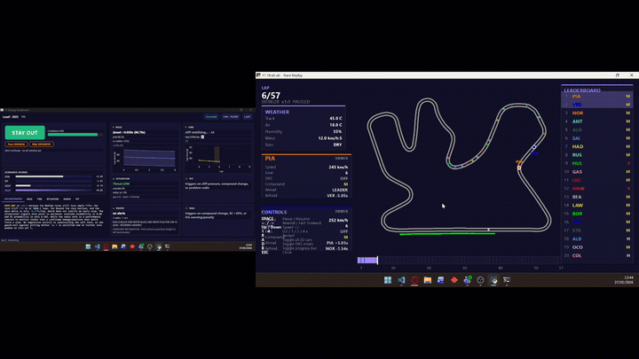
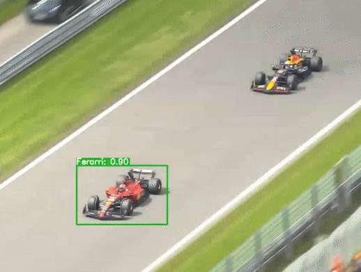

# Hi, I'm Víctor

**Junior AI Engineer at NTT DATA Spain**  
BSc Intelligent Systems Engineering · MSc Artificial Intelligence Research (in progress)

[Portfolio](https://www.victorvegasobral.com) · [LinkedIn](https://www.linkedin.com/in/victorvegasobral/) · [Medium](https://medium.com/@VforVitorio/)

  

I build applied AI systems, from predictive models and computer vision to multi-agent tools. Most of my independent work focuses on Formula 1 analysis, with selected projects outside motorsport.

---

## Selected projects

### F1 StratLab

  
   
  

An open-source system for replaying Formula 1 races and exploring strategy decisions lap by lap. Seven predictive models feed six specialist agents and an orchestrator. The same engine powers a CLI, web app and 2D arcade.

[Repository](https://github.com/VforVitorio/F1-StratLab) · [Demo](https://vforvitorio.github.io/f1stratlab-web/) · [Documentation](https://docs.f1stratlab.com/) · [Paper](https://github.com/VforVitorio/F1-StratLab/raw/main/documents/thesis/F1_StratLab_Paper.pdf)

### F1 AI Team Detection

  

A computer-vision experiment that detects Formula 1 teams in race footage and estimates gaps between cars with YOLOv12 and OpenCV.

[Repository](https://github.com/VforVitorio/F1_AI_team_detection)

### F1 AC Digital Twin

A research prototype for Assetto Corsa telemetry. It combines TCN-based behaviour modelling with a four-expert GMM/MoE anomaly detector, streaming live or replayed telemetry through Kafka, InfluxDB and Grafana.

[Repository](https://github.com/VforVitorio/F1_AC_Digital_Twin)

---

## Other work

**marginalia** turns Kindle Scribe notebooks into reviewed Obsidian Markdown using OCR.

[Repository](https://github.com/VforVitorio/marginalia) · [Website](https://vforvitorio.github.io/marginalia/) · [Demo](https://github.com/VforVitorio/marginalia/blob/main/docs/demo/marginalia-demo.mp4)

## Open-source contributions

Merged contributions to Fast-F1: [Ruff pandas-vet rules](https://github.com/theOehrly/Fast-F1/pull/958) · [`Laps.iterlaps` fix](https://github.com/theOehrly/Fast-F1/pull/960) · [PD010 documentation](https://github.com/theOehrly/Fast-F1/pull/962)
